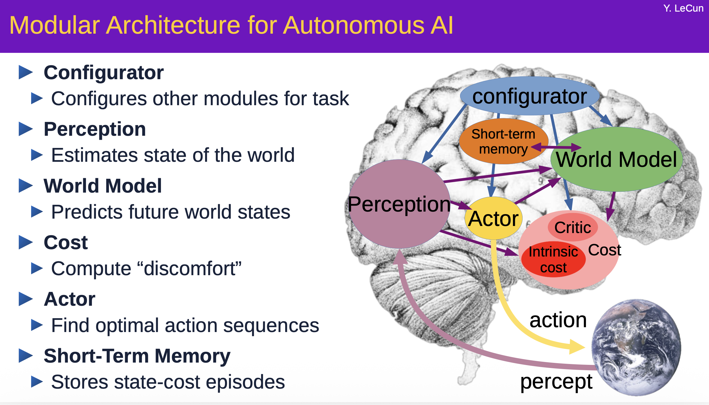
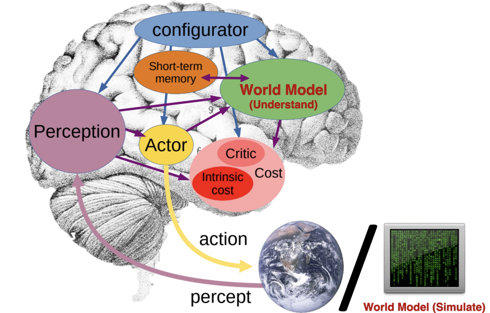
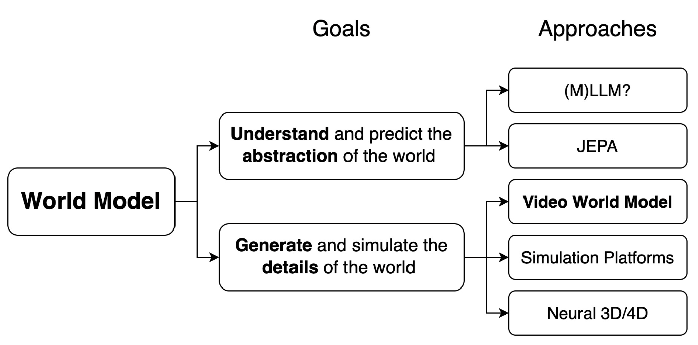
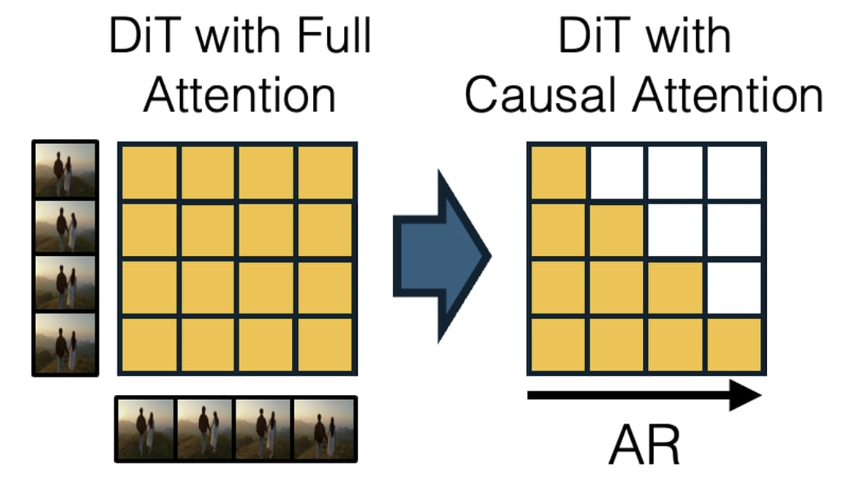
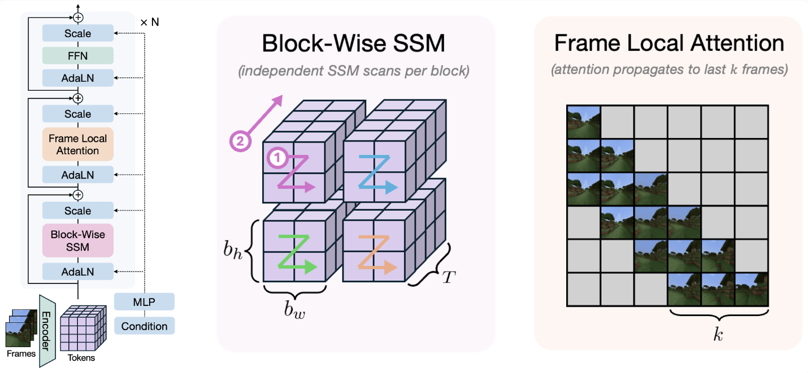
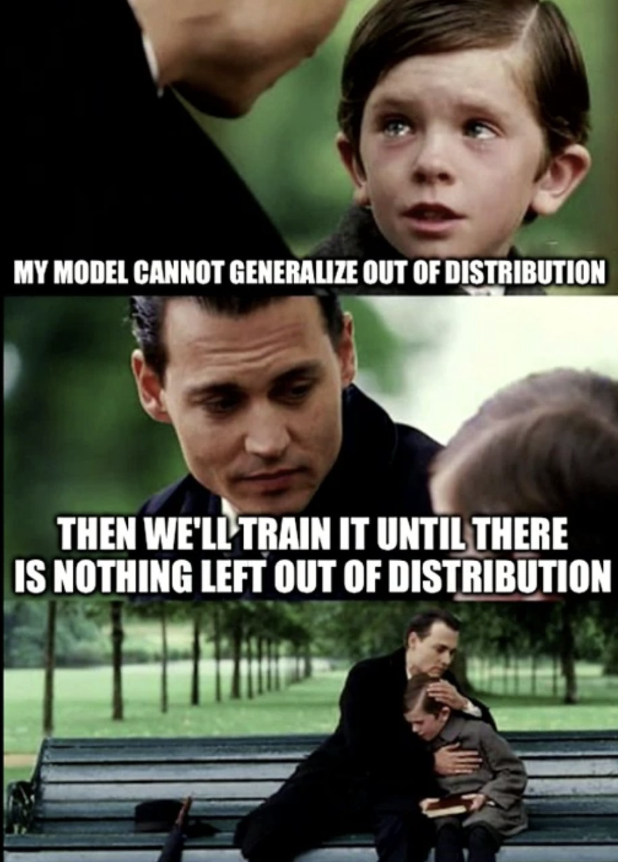
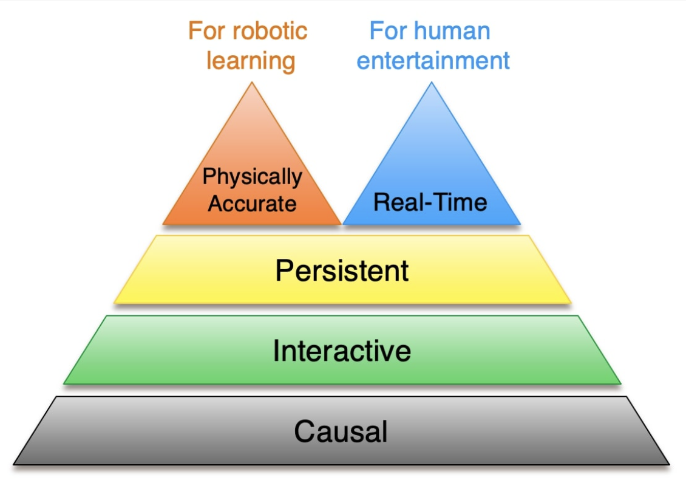

https://www.xunhuang.me/blogs/world_model.html

# 迈向视频世界模型

“世界模型”一词在2025年变得相当流行，但至今仍缺乏一个清晰且普遍认可的定义。在这篇博文中，我将首先厘清这个术语，阐明一些通常被称为世界模型的不同范式。然后，我将重点讨论视频世界模型，这是一类旨在通过视频预测方法模拟世界的特殊世界模型。此外，我还会探讨为什么流行的视频生成器（例如OpenAI的Sora或Google的Veo3）目前还不能称之为真正的世界模型，并概述在视频生成框架中弥合这一差距的途径。

## 1. 什么是世界模型？ 理解世界与模拟世界



<figure style="text-align:center;">
  
  <figcaption>
    图1:人脑中预测粗略未来的内部“世界模型”,与旨在模拟现实每一个细节的外部“世界模型”的对比。该图改编自<a href="https://leshouches2022.github.io/SLIDES/compressed-yann-1.pdf" target="_blank">Yann LeCun的幻灯片</a>。
  </figcaption>
</figure>


一般来说，世界模型能够预测在给定当前状态和特定行动的情况下，世界将如何演变；换句话说，它学习一个函数，该函数以当前世界状态和特定行动为输入，并输出下一个状态。然而，对于这个状态的构成，目前尚无共识。一些研究者将其定义为世界的抽象表征，在这种情况下，世界模型反映了人脑中用于预测高语义层面事件的认知世界模型（cognitive world model）。而另一些研究者则认为世界状态是对世界的详细完整描述。在这种情况下，世界模型是一个完全逼真的世界模拟器，类似于*电影《黑客帝国》* ——一个与现实几乎无法区分的高保真模拟。**尽管目标和方法各不相同，但这两种范式通常都被称为“世界模型**” 。


<figure style="text-align:center;">
  
  <figcaption>
    图 2：世界模型的不同定义和方法的分类。
  </figcaption>
</figure>


第一类世界模型需要能够内化世界知识并在语义空间中进行推理和预测的架构。尽管LLM被认为是一条很有前景的道路，但许多人[认为](https://sergeylevine.substack.com/p/language-models-in-platos-cave)它仅仅依赖文本知识，导致其对现实的理解存在重大缺陷。 一个真正扎根于现实世界的模型必须超越文本，通过视觉、行动和交互来与世界互动。近年来，一些基于长上下文文本和视频训练的多模态模型，例如[LWM](https://arxiv.org/abs/2402.08268)，在这方面展现出了潜力。同样，LeCun 的 JEPA 系列模型（[例如](https://arxiv.org/abs/2402.08268)*V* [-JEPA 2](https://ai.meta.com/blog/v-jepa-2-world-model-benchmarks/)）通过预测掩码抽象视频表示，也推进了这一目标的实现。

尽管模拟<font color="brown">像素级细节</font>对于智能而言并非必要——[正如LeCun所论证的那样](https://www.facebook.com/share/p/1BBDeNBe8g/)——但仍有许多应用需要高保真度的世界模拟器。逼真的模拟使机器人能够在无需承担现实世界交互的成本和限制的情况下学习复杂任务，同时也能为人类用户提供沉浸式的交互体验。在这两种情况下，高质量的视觉效果都至关重要：机器人需要精细的视觉输入来弥合模拟与现实之间的差距，而人类则需要逼真的视觉效果来体验真正的沉浸感。在机器人学习中，内部世界理解模型和外部模拟模型可以协同工作——机器人可以利用通过与模拟环境的外部世界模型交互而学习到的内部世界模型进行规划和行动（plan and act）。

> [!NOTE]
>
> **关键洞见：** “世界模型”是一个含义丰富的术语，既可以指<font color="blue">内部世界理解模型</font>，也可以指<font color="blue">外部世界模拟模型</font>。在具身人工智能的背景下，这两种模型可以协同工作。

构建高保真世界模拟器有多种方法，包括**视频世界模型**、基于物理的仿真平台以及神经3D/4D建模技术。在接下来的章节中，我将重点介绍视频世界模型，并概述从当前最先进的视频生成系统到真实世界模型的演进路径。


## 2. 视频世界模型

过去几年，视频生成技术取得了显著进步，目前最先进的系统能够生成具有逼真细节和物理真实感的动态效果（例如谷歌的Veo3）。谷歌DeepMind首席执行官Demis Hassabis暗示，利用视频生成技术可以开发出具有游戏应用潜力的交互式世界模型。

<iframe
  src="https://platform.twitter.com/embed/Tweet.html?id=1940248521111961988&lang=zh-cn&theme=light&dnt=true"
  width="550" height="350"
  frameborder="0" scrolling="no"
  style="display:block;margin:0 auto;border:none;overflow:hidden;">
</iframe>

但为什么当前的视频生成模型还不能被视为真正的世界模型呢？究竟缺少什么？我们又该如何弥合这一差距？我认为，一个真正的视频世界模型必须具备<font color="brown">**因果性（Causal）、交互性（Interactive）、持久性（Persistent）、实时性（Real-Time）和物理精确性（Physically Accurate）**</font>。在接下来的章节中，我将详细探讨每个属性，强调其重要性并回顾相关研究。

### 因果关系

Causal

<blockquote style="box-sizing:border-box; max-width:680px; margin:8px 0; padding:10px 14px; background:#0b0b0b; border:2px solid #00ee00; border-radius:8px; color:#00ee00;">
  <p style="margin:0; font-size:14px; line-height:1.6;">“你看，世间只有一个恒常不变、放之四海皆准的真理：因果律。行动与反应，原因与结果。”</p>
  <p style="margin:6px 0 0; color:#a0dba0; font:12px/1.5 'Courier New',monospace;">"You see, there is only one constant, one universal, it is the only real truth: causality. Action. Reaction. Cause and effect."</p>
  <p style="margin:7px 0 0; text-align:right; font-size:12px; color:#00cc00;">—— Merovingian，《黑客帝国2：重装上阵》</p>
</blockquote>

因果性[^1]是宇宙的基本属性。然而，目前最先进的视频生成模型主要采用扩散变换器（DiT），它使用非因果的双向注意力机制同时生成一组固定的帧。这种双向注意力机制允许未来的帧信息影响过去的帧，从而违背了现实固有的时间不对称性。因此，在生成初始帧之后，整个视频序列就被预先设定，用户无法动态地与后续事件进行交互或影响。

将因果依赖关系和自回归逐帧生成能力引入视频生成系统，是**构建真实世界模型的第一步**。没有它，实时交互就无从谈起。虽然LLM风格的自回归模型本质上具有因果性，并且已被应用于视频生成，*例如*[CogVideo](https://arxiv.org/abs/2205.15868)和[VideoPoet](https://sites.research.google/videopoet/) ，但由于它们依赖于有损矢量量化来获得离散的潜在空间，因此其质量受到严重限制。此外，一次生成一个标记的速度很慢，而且难以并行化，这使得实现实时速度变得非常困难。

如果能兼具扩散模型的生成质量与速度，以及自回归模型的因果性，那将非常理想。[Diffusion Forcing](https://arxiv.org/abs/2407.01392) 表明，在训练扩散模型时为每一帧独立设置噪声水平，可以使模型具备自回归生成能力。

尽管 Chen 等人的实验主要基于在合成数据集上训练的简单 RNN 架构，[CausVid](https://causvid.github.io/)进一步表明：在互联网规模的视频数据集上预训练、采用双向注意力机制的视频扩散 Transformer，可以成功改造为采用因果注意力机制的自回归扩散 Transformer（AR-DiT）。[MAGI-1](https://github.com/SandAI-org/MAGI-1) 则探索了如何从零开始预训练这类 AR-DiT，并提出了多项针对这一架构的基础设施改进。

<figure style="text-align:center;">
  
  <figcaption>
    图 3：CausVid将具有双向注意力的预训练视频扩散模型转换为具有因果注意力的几步自回归视频扩散模型。
  </figcaption>
</figure>

缺乏交互式控制的因果生成模型是一个被动的世界模拟器，以观察者模式运行。要真正发挥实际作用，世界模型必须支持交互式控制，使用户或代理能够与模拟环境进行实时交互。

### 可交互的

Interactive

交互式可控性是视频世界模型的一个关键特征。它指的是<font color="green">**通过动态注入的动作来影响未来的能力。**</font>不同应用中动作的性质各不相同：游戏玩家可以移动角色和操控物体，机器人必须执行硬件支持的运动指令，而自动驾驶车辆则需要做出转向和加速决策。这些不同场景的共同之处在于，它们都要求世界模型能够动态响应外部干预，并随着新动作的引入而调整其预测。

早期研究主要探索游戏动作控制，并通常采用循环变分自编码器作为生成世界模型（[Ha 和 Schmidhuber，2018](https://worldmodels.github.io/)；[Hafner 等，2020](https://arxiv.org/abs/1912.01603)；[Hafner 等，2021](https://research.google/blog/mastering-atari-with-discrete-world-models/)）。近年来，研究方向转向基于交互动作的（自回归）扩散模型（[Valevski 等，2024](https://gamengen.github.io/)；[Alonso 等，2024](https://diamond-wm.github.io/)），这些模型通常在日益逼真的游戏环境中进行训练（[Feng 等，2024](https://thematrix1999.github.io/)；[Che 等，2025](https://gamegen-x.github.io/)；[Li 等，2025](https://hunyuan-gamecraft.github.io/)）。此外，研究还探索了其他特定应用场景的动作空间，例如自动驾驶车辆的驾驶操作（[Hu 等，2023](https://wayve.ai/science/gaia/)）和导航机器人的运动动作（[Bar 等，2025](https://www.amirbar.net/nwm/)）。

实现交互式控制的核心挑战在于获取能够将视频帧与相应动作对齐的训练数据。虽然可以从游戏环境中获取带标注的数据，但如何利用未标注的、互联网规模的视频来训练交互式世界模型仍然是一个开放性问题。Genie[探索](https://sites.google.com/view/genie-2024/home)了从未标注视频中进行无监督动作学习的方法，而其后续版本[Genie-2](https://deepmind.google/discover/blog/genie-2-a-large-scale-foundation-world-model/)通过利用 AR-DiT 架构展现了令人瞩目的成果。

### 持久的

Persistent

对于大多数世界模拟应用而言，仅生成几秒钟的视频是远远不够的。理想情况下，视频世界模型应该能够生成无限长的视频——或者至少能够生成**足够长的**视频以支持有意义的任务。更重要的是，该模型必须确保**时间上的一致性**，与之前生成的视频保持连贯性。我称之为<font color="green">持久性</font>的这一特性，是视频世界模型的另一项基本要求。

乍一看，生成时长较长且一致的视频似乎仅仅是一个扩展性问题：理论上，一个拥有极长上下文窗口、并基于足够长时长数据训练的Transformer模型应该能够保持时间上的连贯性。然而，世界模型的另一个关键要求——实时响应能力（我稍后会讨论）——使这个问题变得复杂。与用户可以容忍随着上下文窗口增大而增加的推理时间的LLM应用不同，视频世界模型面临着严格的延迟限制。对于游戏等交互式应用而言，系统随时间推移而变慢是不可接受的。一个随着时间推移变得越来越卡顿的世界模型将使游戏体验变得无法进行。

研究人员提出了多种技术来应对这一挑战。一种常见的策略是引入归纳偏置，以积极压缩时间上相距较远的帧，例如[FAR](https://farlongctx.github.io/)和[FramePack](https://lllyasviel.github.io/frame_pack_gitpage/)。虽然这种方法在最近帧包含足够预测信息的场景下效果良好，但当关键细节隐藏在较早的帧中时，它可能会失效——这类似于 LLM 中的“大海捞针”问题。另一项研究将视频生成与持续的 3D 条件相结合（[Ren 等人，2025](https://research.nvidia.com/labs/toronto-ai/GEN3C/)；[Zhang 等人，2025](https://zqh0253.github.io/wvd/)；[Wu 等人，2025](https://spmem.github.io/)；[Zhou 等人，2024](https://arxiv.org/abs/2505.05495)）。虽然这些方法在静态场景中有效，但由于表示明确的 4D 结构的复杂性，它们难以对动态环境进行建模。最后，一个很有前景的方向是使用线性循环神经网络（RNN），例如状态空间模型，来捕获长程时间依赖性，而不会增加每帧的生成时间，[Po 等人（2025](https://ryanpo.com/ssm_wm/) ）首次探索了这种方法。他们的方法将线性 RNN 与 3D 隐藏状态相结合，并融入了局部注意力机制，这让人想起Transformer 时代之前广泛用于视频预测的 经典[ConvLSTM架构。](https://proceedings.neurips.cc/paper_files/paper/2015/file/07563a3fe3bbe7e3ba84431ad9d055af-Paper.pdf)

<figure style="text-align:center;">
  
  <figcaption>
    图 5：状态空间视频世界模型（State-Space Video World Model, Po et al., 2025.）将分块 SSM 扫描与 3D 隐藏状态相结合，以实现长期记忆，并结合局部注意力机制来增强视觉保真度。
  </figcaption>
</figure>

### 实时性

Real-Time

旨在为用户提供交互式体验的视频世界模型需要实时运行，但在此语境下，“实时”究竟意味着什么？要评估模型是否实时运行，需要考虑两个指标：<font color="green">**吞吐量**和**延迟**</font>。吞吐量指的是模型每秒生成的帧数，而延迟指的是每次交互操作与响应帧之间的延迟。实现实时吞吐量——即模型生成的帧数等于或高于用户消费帧数——是提供实时体验的必要条件。

然而，**实时吞吐量还不够**。模型的延迟也必须足够低，用户无法察觉。延迟通常需要小于一秒，而具体的延迟阈值因应用而异。例如，[研究](https://papers.ssrn.com/sol3/papers.cfm?abstract_id=4654242)表明，直播可接受的延迟约为1秒，游戏为 0.1 秒，虚拟现实为 0.01 秒。这也是因果/自回归生成对视频世界模型至关重要的另一个原因：一个具有非因果（non-causal）依赖关系的模型，每次生成 t 秒的视频，其对逐帧交互操作的响应最小延迟为 t 秒。因此，无论模型的吞吐量有多快， **非因果扩散模型永远无法实现真正的实时延迟。**

为了实现实时体验，关键在于将**逐帧因果自回归建模与快速、少步骤的蒸馏扩散**过程相结合，从而生成每一帧。CausVid 是这一领域的先驱，它引入了使用分布匹配蒸馏 (DMD) 训练的 AR-DiT[模型](https://causvid.github.io/)[。](https://tianweiy.github.io/dmd/)后续工作[Self-Forcing](https://self-forcing.github.io/)通过在训练过程中模拟推理过程（使用键值缓存的自回归展开）进一步提升了质量和速度。它在单个 GPU 上实现了实时吞吐量 (17FPS) 和亚秒级延迟，同时达到了与最先进的开源视频扩散模型相当的质量。APT2[探索](https://seaweed-apt.com/2)了类似的训练时展开思路，并进一步证明了此类实时视频模型可以通过交互式控制进行微调。虽然[Decart](https://oasis.decart.ai/welcome)、[Odyssey](https://experience.odyssey.world/)、[Wayfarer Labs](https://wayfarerlabs.ai/blog)和[Dynamics Lab](https://blog.dynamicslab.ai/)等初创公司也进行过演示，但总体而言，其质量和通用性仍然落后于最先进的视频生成模型。

> [!IMPORTANT]
>
> **causal, frame-by-frame autoregressive modeling with a fast, few-step distilled diffusion** 

### 物理精确性

Physically Accurate

视频世界模型的最终目标是成为一个与现实世界难分彼此的世界模拟器。这要求模型不仅要生成视觉上令人愉悦的像素，还要遵循真实世界的物理规律。虽然随着数据和参数的增加，这些模型的物理真实性通常会得到提升，但目前尚不清楚现有模型是否能够真正学习到可泛化和外推的物理定律。Kang[等人](https://phyworld.github.io/)引入了一个通过物理模拟器生成的简单二维数据集，并评估了基于该数据集训练的视频模型的泛化能力。他们发现，尽管组合泛化是可以实现的，但现有模型在观测到的物理属性（*例如*速度、质量）超出分布范围的外推场景中仍然无法有效泛化。

虽然这个结果似乎预示着一个黯淡的未来，但这并不意味着视频世界模型在大多数实际场景中无法有效地模拟世界。除非你试图模拟前沿的物理实验，否则其应用场景的构成很可能与大型互联网视频数据集中的场景类似。毕竟，如果训练分布覆盖了整个世界，那么就没有任何东西会超出分布范围。😉



除了简单地扩展模型规模之外，还有多种技术被提出用于增强视频世界模型的物理真实性。VideoJAM指出[，](https://hila-chefer.github.io/videojam-paper.github.io/)扩散模型中常用的像素重建目标不足以捕捉物理连贯性。为了解决这个问题，它引入了一种联合训练方法，该方法结合了额外的光流去噪目标。另一种方法是数据集整理，以突出那些物理精度更为重要的罕见且分布外的事件。例如，[Ctrl-Crash](https://anthonygosselin.github.io/Ctrl-Crash-ProjectPage/)使用车祸视频素材来微调视频扩散模型，而[PISA 则](https://github.com/vision-x-nyu/pisa-experiments)使用合成或真实世界的物体掉落视频来微调该模型。

### 概括

我概述了视频世界模型的五个关键属性：因果性、交互性、持久性、实时响应性和物理精度，大致按从最基本到最具挑战性的顺序排列。前两个属性——因果性和交互性——是硬性约束。世界模型必须具有因果性和交互性，其中因果性更为根本，是实现交互控制的前提。持久性是一个软性约束，存在于一个连续的谱系中；理想的世界模型需要生成无限长且完全一致的视频，但即使是持久性适中的模型在许多应用中也很有价值。**实时响应性和物理精度（后两个属性）之间存在权衡**：较大的模型往往具有更高的物理精度，但速度较慢，而较小的模型是实现实时响应的必要条件，但物理精度较低。我预计**不同的世界建模应用会优先考虑其中一项属性**。对于人类娱乐而言，实时响应性至关重要，而物理精度只需足够欺骗人眼即可。对于机器人学习而言，物理精度是最重要的，而模型训练期间的实时仿真并非真正必要。

<figure style="text-align:center;">
  
  <figcaption>
    图 8：视频世界模型的层级结构呈双头金字塔形。实时响应性和物理精确性之间存在权衡，我预计不同的应用会优先考虑其中一项。
  </figcaption>
</figure>


## 3. 世界模拟的其他方法

视频世界模型为模拟世界提供了一种极具前景的新方法，但这仅仅是众多途径之一。传统的模拟器将用于动力学的物理引擎与用于图像渲染的渲染器相结合；诸如[MuJoCo](https://github.com/google-deepmind/mujoco)、[Isaac](https://developer.nvidia.com/isaac)和[Genesis](https://github.com/Genesis-Embodied-AI/Genesis)等平台可以无缝集成到机器人学习流程中。然而，在这些引擎中创建逼真的场景和特定任务的世界通常需要大量的人工操作，并且限制了灵活性。最近的研究开始探索使用 LLM 代理自动生成环境，这有望实现快速、按需创建新场景。

另一种世界建模方法是使用神经网络生成明确的 3D/4D 世界表示，例如 3D/4D 高斯散射。该领域的最新研究成果包括[Wonderland](https://snap-research.github.io/wonderland/)、[WonderWorld](https://kovenyu.com/wonderworld/)、[Bolt3D](https://szymanowiczs.github.io/bolt3d)等。World [Labs](https://www.worldlabs.ai/blog)和[SpAItial](https://www.spaitial.ai/)等初创公司似乎也在朝着这个方向努力。

<div style="max-width:760px; margin:18px auto; overflow-x:auto;">
<table style="width:100%; border-collapse:separate; border-spacing:2px; background:#fff; font-size:14px; line-height:1.4; text-align:center;">
  <thead>
    <tr style="background:#4e73b9; color:#fff;">
      <th style="width:25%; padding:10px 8px; border:0;"></th>
      <th style="width:25%; padding:10px 8px; border:0;">Simulation Platform</th>
      <th style="width:25%; padding:10px 8px; border:0;">Neural 3D/4D</th>
      <th style="width:25%; padding:10px 8px; border:0;">Video World Model</th>
    </tr>
  </thead>
  <tbody>
    <tr style="background:#d0d6e7;">
      <td style="padding:9px 8px; border:0; color:#202735; font-weight:600;">Dynamic Physics</td>
      <td style="padding:9px 8px; border:0; color:#587b42; font-weight:600;">Good</td>
      <td style="padding:9px 8px; border:0; color:#ad2929; font-weight:600;">N/A</td>
      <td style="padding:9px 8px; border:0; color:#b56732; font-weight:600;">Mid</td>
    </tr>
    <tr style="background:#e8ebf3;">
      <td style="padding:9px 8px; border:0; color:#202735; font-weight:600;">3D Consistency</td>
      <td style="padding:9px 8px; border:0; color:#587b42; font-weight:600;">High</td>
      <td style="padding:9px 8px; border:0; color:#587b42; font-weight:600;">High</td>
      <td style="padding:9px 8px; border:0; color:#ad2929; font-weight:600;">Low</td>
    </tr>
    <tr style="background:#d0d6e7;">
      <td style="padding:9px 8px; border:0; color:#202735; font-weight:600;">Photorealism</td>
      <td style="padding:9px 8px; border:0; color:#b56732; font-weight:600;">Mid</td>
      <td style="padding:9px 8px; border:0; color:#b56732; font-weight:600;">Mid</td>
      <td style="padding:9px 8px; border:0; color:#587b42; font-weight:600;">High</td>
    </tr>
    <tr style="background:#e8ebf3;">
      <td style="padding:9px 8px; border:0; color:#202735; font-weight:600;">Speed</td>
      <td style="padding:9px 8px; border:0; color:#b56732; font-weight:600;">Mid</td>
      <td style="padding:9px 8px; border:0; color:#587b42; font-weight:600;">High</td>
      <td style="padding:9px 8px; border:0; color:#ad2929; font-weight:600;">Low</td>
    </tr>
    <tr style="background:#d0d6e7;">
      <td style="padding:9px 8px; border:0; color:#202735; font-weight:600;">Generalizability</td>
      <td style="padding:9px 8px; border:0; color:#ad2929; font-weight:600;">Low</td>
      <td style="padding:9px 8px; border:0; color:#b56732; font-weight:600;">Mid</td>
      <td style="padding:9px 8px; border:0; color:#587b42; font-weight:600;">High</td>
    </tr>
  </tbody>
</table>
<p style="margin:10px 0 0; text-align:center; color:#777; font-size:13px; font-style:italic;">不同世界模拟方法的优缺点。</p>
</div>


不同的方法各有优缺点。基于物理的模拟器在生成一致且符合物理规律的结果方面更为有效，但通常需要人工设计特定任务场景。此外，传统的渲染流程在实时计算的限制下难以实现完全逼真的效果。神经3D方法能够生成渲染速度快且符合3D规律的表示，但它们在模拟动态场景方面通常面临挑战。而基于视频的世界模型则具有高度的适应性，能够生成视觉效果惊艳、逼真的输出。然而，如何在实时渲染的同时实现3D一致性——我之前称之为“持久性”和“实时性”的挑战——仍然是一个尚未解决的问题。短期来看，开发结合不同范式优势的混合模型或许是一个有益的方案。例如，[WonderPlay](https://kyleleey.github.io/WonderPlay/)将基于物理的模拟器、3D高斯表示和视频扩散模型结合起来，生成具有物理精确动态效果的逼真世界。

**免责声明：**作者并非基于物理的模拟或神经渲染领域的专家。请谨慎看待我在此提出的观点。


## 4. 结论

“世界模型”一词含义丰富：它既可以指预测高层次结果的抽象模型，也可以指与现实难以区分的精细模拟。在这篇博文中，我将重点讨论后一种定义，概述从视频生成过渡到真正的视频世界建模所需的关键特性。这是一个激动人心的时代，因为由世界模型驱动的交互式媒体有望成为内容创作的下一个前沿领域（继图像和视频生成之后），同时，世界模型也将推动机器人学习领域出现变革性的新范式。

引用

如果您觉得这篇文章有用，请考虑引用：

```latex
@misc{huang2025towards,
  title={迈向视频世界模型},
  author={黄迅},
  year={2025},
  url={https://www.xunhuang.me/blogs/world_model.html}
}
```


[^1]: **因果性(Causality)**:在此语境下,因果性指时间的单向性,即过去决定未来,而不是相反。它不同于因果机器学习中的概念,后者关注的是如何区分因果关系与相关性。
