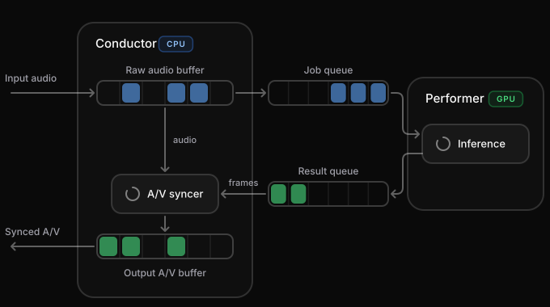

https://lemonslice.com/cwm-1

终极目标：EQ model，给目前极高IQ的模型一个视觉上的EQ layer。通过图灵测试。

### 步数蒸馏

#### CausVid

https://github.com/tianweiy/CausVid

#### Self-Forcing

https://github.com/guandeh17/Self-Forcing

### 稀疏注意力

#### MonarchRT

https://github.com/Infini-AI-Lab/MonarchRT

### 误差累积

LemonSlice说是用了黑科技解决：

We invented a unique solution to this. The solution is at the intersection of GAN-based training and intelligent attention weighting.

### 硬件优化

Rolling KV cache eviction

### 系统架构

实时交互的编排中枢，也就是Model Harness

模型的 harness(驾驭层)负责统筹调度整个实时交互过程。概括地说,我们用两个相互协作的独立进程,持续不断地输出视频和音频流,全程不卡顿。**Conductor(指挥者)** 工作进程充当对外接口,接收音频数据包,并输出音画同步的音视频数据包。**Performer(表演者)** 则利用 GPU 生成新的视频帧。

最具挑战的部分,是应对不断变化的用户输入。比如用户打断时,我们必须以最快速度调整视频输出。为此,我们投入了大量精力,对 GPU 和队列进行智能清空,同时确保不会生成任何延迟帧。

Model Harness对于实时应用都很重要。这在我们ZVA avatar项目里也体会到了。