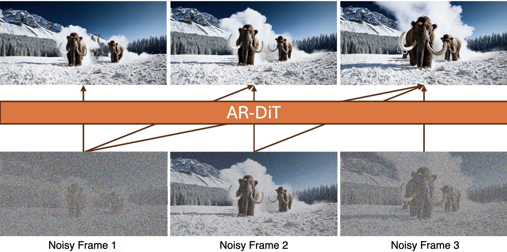
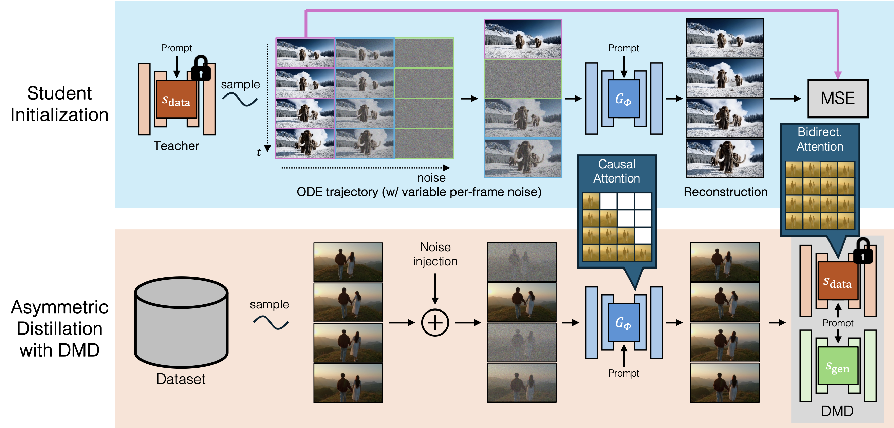
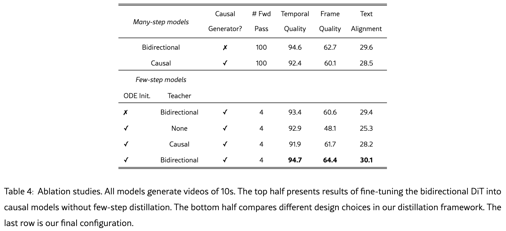
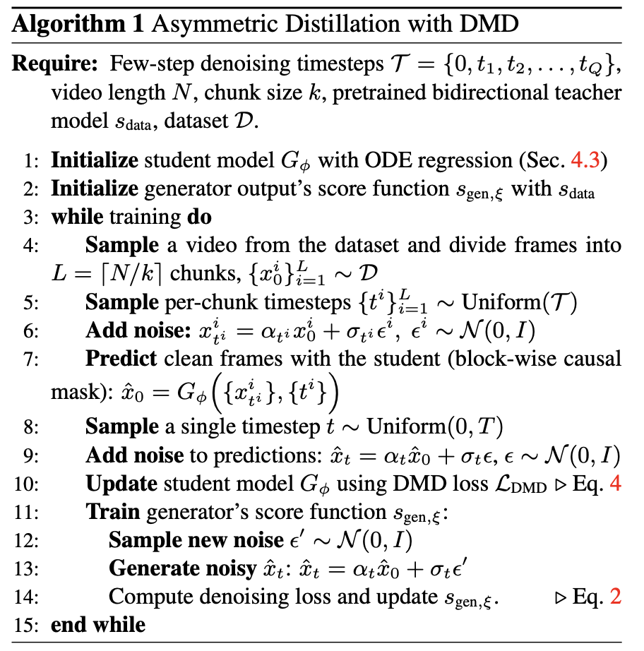
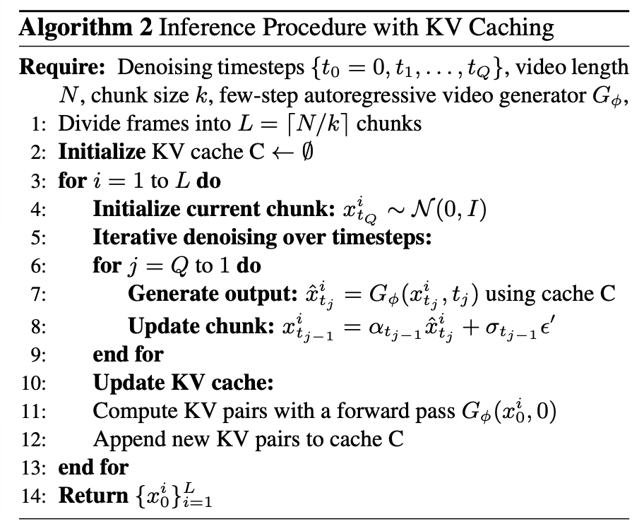
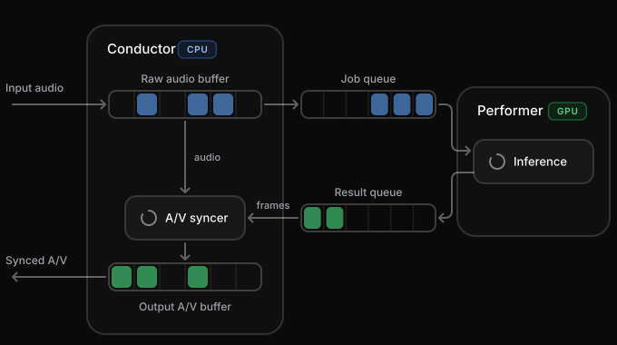

https://lemonslice.com/cwm-1

终极目标：EQ model，给目前极高IQ的模型一个视觉上的EQ layer。通过图灵测试。

### 步数蒸馏

#### CausVid

https://github.com/tianweiy/CausVid

也是用distribution matching distillation (DMD)，但自研了一些技巧：学生网络的初始化、不对称的蒸馏策略。

###### intro

回顾了普通的DiT模型（慢）和自回归模型（误差累积）。

> **DiT 回顾**：扩散模型学习从噪声中逐步去噪。DiT 把 U-Net 换成 Transformer：视频的 latent 先切成 patch 变成 token，时间步和条件通过 adaLN 等方式注入，网络预测噪声或速度场。

主要贡献：

1. **因果注意力（causal dependencies）**：传统视频扩散模型用双向注意力（bidirectional attention），每一帧都能看到整段视频，包括未来帧。CausVid 改成因果结构，第 $t$ 帧只依赖第 $\le t$ 帧，所以可以逐帧生成。

   > 核心技巧：
   >
   > 1. **非对称蒸馏（asymmetric distillation）**：教师模型是双向注意力的预训练扩散模型，学生模型是因果模型。直接蒸馏一个自回归扩散模型效果不好，而用双向教师指导因果学生，论文称可以显著减少误差累积。

2. **样本高效训练（sample-efficient training）**：借鉴 LLM 的做法。在一次前向计算中，所有帧都同时参与训练，每一帧都能提供去噪监督信号，而不是只监督一个样本或一帧。这和 GPT 类模型对序列中每个位置都做 next-token 预测是同一思路。

3. **KV cache 加速推理**：生成新帧时，把之前帧的 Key/Value 缓存下来，只需为新帧计算一次，避免每一步重复计算整段历史。

   > #### Transformer 中的 Q、K、V
   >
   > Token 与表示：输入（文本 token，或视频的 patch/帧）先映射为向量，组成矩阵：
   > $$
   > X \in \mathbb{R}^{n \times d}
   > $$
   >
   > 其中 $n$ 是 token 个数，$d$ 是向量维度，每一行对应一个 token。
   >
   > Q、K、V 的来源
   >
   > 用三组可学习的权重矩阵对同一个输入 $X$ 做线性投影：
   >
   > $$
   > Q = X W_Q,\quad K = X W_K,\quad V = X W_V
   > $$
   >
   > 其中 $W_Q, W_K \in \mathbb{R}^{d \times d_k}$，$W_V \in \mathbb{R}^{d \times d_v}$。同一个输入通过三个不同的矩阵，得到三种“视角”。
   >
   > #### 注意力公式
   >
   > $$
   > \text{Attention}(Q,K,V) = \text{softmax}\left(\frac{QK^\top}{\sqrt{d_k}}\right)V
   > $$
   >
   > - $QK^\top \in \mathbb{R}^{n \times n}$：第 $i$ 行第 $j$ 列表示第 $i$ 个 token 对第 $j$ 个 token 的相关性分数。
   > - $\sqrt{d_k}$：缩放因子，防止点积过大导致 softmax 梯度消失。
   > - softmax 按行归一化，得到注意力权重。
   > - 最后用权重对 $V$ 加权求和。
   >
   > #### 直观理解
   >
   > | 向量 | 名称  | 含义                                           |
   > | ---- | ----- | ---------------------------------------------- |
   > | $Q$  | Query | 当前 token 在“查询”什么                        |
   > | $K$  | Key   | 每个 token 对外“标注”的特征，用于和 Query 匹配 |
   > | $V$  | Value | 每个 token 实际携带的内容                      |
   >
   > 对第 $i$ 个 token：
   >
   > 1. 用 $q_i$ 与所有 $k_j$ 做点积，得到相关性分数。
   > 2. 经 softmax 转为权重 $\alpha_{ij}$。
   > 3. 对所有 $v_j$ 加权求和，得到新表示：
   >
   > $$
   > y_i = \sum_{j} \alpha_{ij} v_j, \quad \alpha_{ij} = \frac{\exp(q_i \cdot k_j / \sqrt{d_k})}{\sum_{l} \exp(q_i \cdot k_l / \sqrt{d_k})}
   > $$
   >
   > #### Multi-Head Attention
   >
   > 把 $d$ 切成多个头，每个头独立做上面的计算，最后拼接。不同的头可以关注不同类型的关系。
   >
   > #### 与 KV Cache 的关系
   >
   > - 在因果（causal）注意力中，第 $i$ 个位置只能看到 $j \le i$ 的位置。
   > - 新 token 加入时，旧 token 的 $K_j = x_j W_K$ 和 $V_j = x_j W_V$ 不会改变，因此可以缓存。（<font color="brown">双向注意力就做不到这点</font>）
   > - 推理时每一步只需计算新 token 的 $q_t, k_t, v_t$，再让 $q_t$ 与缓存中的 $K_{1..t}$ 做注意力。
   > - **代价**：显存随序列长度线性增长。长视频会占用大量显存，所以实践中常用滑动窗口或限制最长缓存。
   > - 注意：**在视频扩散中**，需要注意去噪过程中当前帧的 K、V 会变化，只能缓存已完成的帧。

###### related

长视频生成现有路线

1. **多片段重叠生成**：用在固定短片段上预训练的视频扩散模型，同时生成多个重叠片段，并通过各种策略保证时序一致性（如 FreeNoise、SEINE、DiffCollage 等）。
2. **分层生成**：先生成稀疏关键帧，再在关键帧之间插值（如 NUWA、MovieDreamer）。
3. **自回归生成**：天然适合任意长度视频，但长序列存在误差累积（error accumulation）问题。

- 本文观点：在自回归框架中，使用双向教师模型的分布匹配目标（DMD）能有效抑制误差累积，从而同时实现高效且高质量的长视频生成。

###### background

视频扩散模型的基本思想是：从真实样本 $x_0$ 出发，逐步加入高斯噪声，得到 $x_t = \alpha_t x_0 + \sigma_t \epsilon$，其中 $\epsilon \sim \mathcal{N}(0, I)$，$\alpha_t$ 表示保留的信号强度，$\sigma_t$ 表示噪声强度，二者由噪声调度（noise schedule）决定，共同定义每个时间步的信噪比。$t$ 越大，噪声越多。采样时则反过来，从纯噪声 $x_T$ 出发，逐步去噪，得到干净样本。

分布匹配蒸馏 DMD

DMD 的训练流程是：先用预训练的扩散模型同时初始化 $s_{\text{data}}$ 和 $s_{\text{gen}}$，然后冻结 $s_{\text{data}}$；每一步用学生生成样本、加噪、计算两个分数的差作为修正方向，更新学生；再用学生的输出训练 $s_{\text{gen}}$，使其学会学生当前的分布。$s_{\text{gen}}$ 的训练就是普通的去噪损失，即让网络预测加入的噪声。原始 DMD 只能单步生成，输入是纯噪声。DMD2 把输入换成部分去噪的中间样本，扩展到多步生成，这对 CausVid 的少步学生很关键。

v-prediction 的名字来自速度的含义。假设 $\alpha_t^2 + \sigma_t^2 = 1$，令 $\alpha_t = \cos\phi$，$\sigma_t = \sin\phi$，则 $x_t$ 在信号与噪声构成的平面上旋转，对角度求导得到的沿轨迹速度就是 $v = \alpha_t \epsilon - \sigma_t x_0$。在理想情况下，$\epsilon$-prediction、$x_0$-prediction 和 v-prediction 是等价的，但在有限网络中，它们对不同噪声水平的损失权重不同。此外 v 的方差与 $t$ 无关，反推 $x_0$ 时没有除以 $\alpha_t$ 的步骤，因此在少步蒸馏中更稳定。

> VP（variance-preserving，保持方差）是一种加噪约定，要求 $\alpha_t^2 + \sigma_t^2 = 1$。它的来龙去脉可以这样理解。
>
> 加噪公式是 $x_t = \alpha_t x_0 + \sigma_t\epsilon$，其中 $\epsilon$ 是方差为 1 的标准高斯噪声。假设 $x_0$ 与 $\epsilon$ 相互独立，则 $\text{Var}(x_t) = \alpha_t^2\,\text{Var}(x_0) + \sigma_t^2$。如果数据的方差 $\text{Var}(x_0)$ 为 1，这个式子就变成 $\alpha_t^2 + \sigma_t^2 = 1$，于是加噪后的方差始终保持为 1，不随 $t$ 变化。这就是 VP 的由来：它是为了让"信号的比例"和"噪声的比例"此消彼长，而总能量不变。
>
> 这里有一个前提：数据的方差需要大致为 1。这一点不是天然满足的。通常的做法是对数据做一个固定的全局缩放，使数据集的整体标准差接近 1。例如，LDM 的潜变量乘一个在数据集上统计得到的常数（如 Stable Diffusion 中约 0.18215）。这个常数是预处理，

> [!TIP]
>
> 一句话理解 score
>
> Score 是一个方向：在当前这个带噪样本上，往哪边走会更像真实数据。扩散网络学的就是这个方向，所以说网络就是 score 模型。
>
> 和噪声的关系
>
> 网络通常预测"加进去的噪声"。噪声指向的是"远离真实数据"的方向，所以取反就是"靠近真实数据"的方向。再按噪声强度做一次缩放，就得到 score。缩放的具体写法取决于论文用哪种参数化，常见写法是 score 等于负的噪声预测除以噪声强度，$\text{score} = -\hat\epsilon / \sigma_t$，但这只是一种约定。
>
> 为什么要关心这个方向：有了方向，就能从噪声一步步走到真实样本，这就是采样。蒸馏时，老师和学生各自给出方向，学生只要让两者的差距变小，就能学会用更少的步数生成样本。
>
> score function、score model 和扩散模型的关系
>
> - score function 是一个数学对象，指的是"在某个带噪样本上，往哪个方向走更像真实数据"。它不依赖任何具体的网络，只是一个从（样本，噪声水平）到方向的函数。它是我们想要知道的东西。
>
>
> - score model 是用神经网络去近似 score function 的那个网络。因为真实的 score function 无法直接写出来，所以训练一个网络来逼近它。网络的输出可以有多种形式：直接输出方向，输出加进去的噪声，输出干净样本，或输出 v-prediction。这些形式之间可以互相换算，所以它们都可以被看作同一个 score model 的不同读法。
>
>
> - 扩散模型是完整的系统，包括三部分：一个加噪的前向过程，用于生成训练数据；一个 score model，用于学习方向；以及一个采样过程，用于从噪声一步步走回样本。score model 只是扩散模型中的一个部件，但它是最核心的部件，因为采样时每一步都要靠它来决定往哪里走。
>
>
> 三者的关系可以概括为：score function 是目标，score model 是对目标的近似，扩散模型是利用这个近似来生成样本的整套方法。
>
> 在 DMD 里，老师网络就是一个训练好的 score model，它给出的是真实数据的方向；学生网络则是另一套生成器，它直接输出样本，不需要成为 score model；而 s_fake 也是一个 score model，只不过它的训练数据来自学生的输出，所以它代表的是学生分布的方向。

$\hat\epsilon$、$\hat x_0$、$v$、score 之间的换算

```python
eps_hat = (x_t - alpha_t * x0_hat) / sigma_t     # 由 x0 得到噪声
x0_hat  = (x_t - sigma_t * eps_hat) / alpha_t    # 由噪声得到 x0
v_hat   = alpha_t * eps_hat - sigma_t * x0_hat   # 由噪声和 x0 得到 v
score   = -eps_hat / sigma_t                     # 由噪声得到方向
```

$score = -\epsilon/\sigma_t$

所以，更一般地，不依赖噪声参数化的写法是 $\text{score} = (\alpha_t\hat x_0 - x_t)/\sigma_t^2$。

直观地说，噪声大时，每一步的方向感很弱（score 小）。

> 噪声大时，分布很宽，概率在较大范围内变化平缓，因此 score 的数值小，每一步的方向感较弱。但此时样本离真实数据很远，需要修正的距离大，去噪误差也大。score 小和误差大并不矛盾：前者描述的是当前位置的局部斜率，后者描述的是终点有多远。
>
> 噪声小时，分布很窄，数据附近的概率变化剧烈，因此 score 的数值大。但样本已经接近真实数据，需要修正的距离小。
>
> 采样时，步数由采样器事先设定，不会因单个样本的修正量而改变。每一步的实际位移由三部分共同决定：score 给出方向和变化速率，该步的时间跨度决定这一步占整个过程的比例，调度系数决定噪声与信号的比例如何随时间变化。因此，噪声大时即使 score 小，只要该步的时间跨度较大，单步位移仍可能不小；噪声小时，则常通过更细的时间切分来避免过冲。
>
> 一句话概括：score 决定每一步往哪边、以多快的速率走；采样器的时间切分决定每一步走多远；这儿步数是事先选定的超参数。

DMD伪代码：

```python
# ===== 三个网络 =====
G       = student_generator()   # 学生：少步生成视频，唯一要训练的"生成器"
s_real  = teacher_score()       # 老师：预训练的扩散模型，训练中冻结（不更新）
s_fake  = copy_of(s_real)       # 辅助：跟踪"学生当前输出"的分布，在线更新

opt_G    = Adam(G.parameters())
opt_fake = Adam(s_fake.parameters())

for step in range(num_steps):

    # ---------- 第一步：更新学生 G ----------
    noise = sample_noise()
    x = G(noise)                          # 学生生成一批样本

    t = sample_random_timestep()          # 随机选一个噪声水平
    x_t = add_noise(x, t)                 # 给生成结果加噪（和扩散模型一样的做法）

    # 老师和辅助网络分别给出"往哪个方向调整更好"的信号
    score_real = s_real(x_t, t)           # 老师：指向真实数据方向
    score_fake = s_fake(x_t, t)           # 辅助：指向当前生成分布方向

    # 关键一行：两个方向的差值，就是学生的修正方向
    grad = score_fake - score_real        # 注意符号：下面用 x 减去它，实际是朝 real 走

    # 技巧：把 grad 当成常数，只让它告诉 x 怎么动，不反向传播进老师和辅助网络
    target = (x - grad).detach()
    loss_G = mse(x, target)               # 最小化它，x 就朝 real - fake 的方向移动

    opt_G.zero_grad()
    loss_G.backward()
    opt_G.step()

    # ---------- 第二步：更新辅助网络 s_fake ----------
    # s_fake 的任务：学会"当前学生输出长什么样"，就像训练一个普通扩散模型一样
    x_fake = G(sample_noise()).detach()   # 学生的输出，不反传给 G
    t2 = sample_random_timestep()
    x_fake_t = add_noise(x_fake, t2)

    loss_fake = denoising_loss(s_fake, x_fake_t, t2, x_fake)  # 预测加进去的噪声
    opt_fake.zero_grad()
    loss_fake.backward()
    opt_fake.step()
```

具体注释：

```python
# ===== 三个网络 =====
'''
G（学生生成器）
- 唯一需要训练的网络，也是最终拿来用的模型。
- 输入：噪声（DMD2/CausVid 中还可以是部分去噪的样本）。
- 输出：干净样本 x0（视频 latent），而不是噪声。
- 结构通常与老师相同（DiT 或其因果版本），有时会缩小规模。
- "一步" = 只调用一次 G；"少步" = 反复调用 G，中间做加噪。
'''
G = student_generator()

'''
s_real（老师，冻结）
- 预训练好的扩散模型，训练过程中参数不更新。
- 它输出的是噪声预测 eps_pred，可以换算成 score：score = -eps_pred / sigma_t。
- 代表"真实数据的方向"：朝它走，样本会变得更像真实数据。
- 训练时只做前向计算，不参与反向传播。
'''
s_real = teacher_score()

'''
s_fake（副本，可训练）
- 一开始是老师的完整复制（copy_of），因此起点就具备去噪能力。
- 训练数据不是真实视频，而是学生 G 的输出。
- 训练完成后，它学到的是"学生输出分布的形状"，代表"学生当前扎堆的地方"。
- 名字里的 fake 指它建模的是学生生成的分布，而不是它本身是假的网络。
'''
s_fake = copy_of(s_real)

opt_G    = Adam(G.parameters())
opt_fake = Adam(s_fake.parameters())

for step in range(num_steps):

    # ---------- 第一步：更新学生 G ----------
    '''
    目标：让 G 的输出朝"真实方向、远离学生自身扎堆区"移动。
    这是对反向 KL 梯度的近似，mode-seeking 的来源就在这里。
    '''
    noise = sample_noise()
    x = G(noise)                          # 学生生成一批干净样本 x0

    '''
    随机选一个噪声水平 t，并对 x 加噪。
    老师和副本都是在"带噪样本"上工作的，所以必须先加噪。
    t 随机采样，使各个噪声水平都被覆盖到。
    '''
    t = sample_random_timestep()
    x_t = add_noise(x, t)                 # x_t = alpha_t * x + sigma_t * eps

    '''
    两个方向信号：
    - score_real：指向真实数据密度高的地方（吸引）。
    - score_fake：指向学生自己扎堆的地方（用于排斥）。
    注意两者都是在同一个带噪样本 x_t、同一个 t 上计算的，差值才有意义。
    '''
    score_real = s_real(x_t, t)           # 老师给出的方向
    score_fake = s_fake(x_t, t)           # 副本给出的方向

    '''
    grad = score_fake - score_real 不是 x 减去 score，而是两个"方向"之差。
    它的含义是：
        -grad = score_real - score_fake
    即"朝真实数据走，但别挤在学生已经很多的地方"。
    如果只用 score_real，所有样本会坍缩到密度最高的那几个点上（模式坍缩）。
    '''
    grad = score_fake - score_real

    '''
    target = (x - grad).detach() 的作用：
    - detach()：把 grad 当作常数，梯度只流向 G，不流回老师和副本。
    - x - grad = x + (score_real - score_fake)：样本朝目标方向移动。
    - mse(x, target)：最小化它，就等价于让 x 沿 -grad 移动。
    这是一个常见的实现技巧，把"自定义梯度"包装成普通的 MSE 损失。
    '''
    target = (x - grad).detach()
    loss_G = mse(x, target)

    opt_G.zero_grad()
    loss_G.backward()
    opt_G.step()

    # ---------- 第二步：更新副本 s_fake ----------
    '''
    目标：让 s_fake 学会"学生当前的输出长什么样"。
    这一步完全不改变 G，只训练 s_fake。
    它的训练方式与普通扩散模型相同：去噪，即预测加进去的噪声。
    '''
    x_fake = G(sample_noise()).detach()   # 学生的输出，不让梯度回到 G

    '''
    denoising_loss 的过程：
    1. 生成随机噪声 eps（这是"标准答案"）。
    2. 用 eps 对 x_fake 加噪，得到 x_fake_t。
    3. 让 s_fake 根据 x_fake_t 和 t 预测 eps。
    4. 计算预测值与真实 eps 的误差。
    注意：eps 只能在函数内部生成，因为只有它知道加进去的噪声是什么。
    '''
    t2 = sample_random_timestep()
    loss_fake = denoising_loss(s_fake, x_fake, t2)

    opt_fake.zero_grad()
    loss_fake.backward()
    opt_fake.step()

'''
整体直觉（一句话）：
- s_real 把样本往真实数据拉；
- s_fake 监测学生自己扎堆的地方，并把样本推开；
- G 同时受这两股力影响，所以既能靠近真实分布，又能保持多样性。
'''
```

反向KL散度理解：

```python
'''
前向 KL 的行为。q 必须"覆盖"p 的所有模式。
反向 KL 的行为。q 不需要覆盖所有模式，它会"寻找"并锁定其中一个或几个模式，然后集中在那里。
'''
import numpy as np

EPS = 1e-12  # 防止除以 0 或 log(0)

'''
【核心规则：谁是分母，谁决定哪里会被重罚】

KL(a || b) = sum a * log(a / b)

- 期望是在 a 上取的：a 有质量的地方才计入惩罚。
- 分母是 b：b 很小而 a 很大时，log(a/b) 会爆炸，loss 巨大。

所以：
- 前向 KL(p || q)：分母是 q。p 有质量而 q 没有 → 重罚 → q 必须覆盖 p 的所有模式。
- 反向 KL(q || p)：分母是 p。q 有质量而 p 没有 → 重罚 → q 只敢待在 p 的高密度区。
'''

def forward_kl(p, q):
    '''
    前向 KL：KL(p || q)，以真实数据 p 为准。
    惩罚发生在：p 有质量、q 没有（分母 q 很小）。
    后果：q 会尽量在所有地方都有质量，覆盖全部模式（mode-covering）。
    代价：两个模式之间可能生成模糊的"平均"样本。
    '''
    return np.sum(p * np.log((p + EPS) / (q + EPS)))

def reverse_kl(p, q):
    '''
    反向 KL：KL(q || p)，以生成结果 q 为准。
    惩罚发生在：q 有质量、p 没有（分母 p 很小）。
    后果：q 不敢在 p 概率低的地方放质量，只集中在某个模式上（mode-seeking）。
    代价：可能漏掉部分模式，多样性下降。
    DMD 使用的就是这一种。
    '''
    return np.sum(q * np.log((q + EPS) / (p + EPS)))

# 真实数据：只在两个格子上有质量，即两个"模式"
p_data = np.array([0.5, 0.0, 0.0, 0.5])

# 候选 A：摊开，覆盖两个模式，但中间也有质量
q_spread = np.array([0.25, 0.25, 0.25, 0.25])

# 候选 B：集中在第一个模式上
q_focus = np.array([0.97, 0.01, 0.01, 0.01])
```

###### methods

**method 章节总览**

目标：把一个多步、双向的视频扩散模型，蒸馏成 4 步、因果的流式生成器 $G_\phi$。

三个关键设计：

1. 自回归架构：分块因果注意力（4.1）
2. 训练：非对称蒸馏（4.2）+ ODE 初始化（4.3）
3. 推理：KV cache（4.4）

**4.1 Autoregressive Architecture**

目标：设计学生生成器 $G_\phi$，使它既能逐 chunk 流式生成，又尽量保持质量。

流程：3D VAE 按 chunk 独立编码，把视频压成潜帧。DiT 只在潜空间中按 chunk 顺序生成，解码器再还原像素。

分块因果注意力（block-wise causal attention）：

- 块内：潜帧之间双向注意力，用来建模局部时序依赖，保证一致性。
- 块间：因果注意力，当前 chunk 只能看自己和之前的 chunk。
- 掩码：$M_{i,j}=1 \iff \lfloor j/k \rfloor \le \lfloor i/k \rfloor$，$k$为 chunk 大小。
- 例：$k=2$时，第 2 帧可见第 0–3 帧，第 0 帧只可见第 0–1 帧。

实现：在 DiT 上只把自注意力换成带掩码的版本，其余结构不变，所以能复用预训练的双向权重，收敛更快。

延迟：论文称与完全因果注意力相同。原因是 3D VAE 解码器至少需要一个 chunk 的潜帧才能输出像素，所以块内双向不增加等待时间。

- 前提：以 chunk 为生成和解码单位。若换成逐帧解码，完全因果可以逐帧输出，分块因果的首帧延迟就会更大。

**图 5的理解**



- 下排是带不同噪声的输入 chunk，中间是 AR-DiT，上排是各位置的去噪输出。
- 箭头表示信息流向：输出 $i$只依赖输入 $1\ldots i$，即因果（下三角）注意力。
- 图中的 "Frame" 实际是 chunk，每块只画了一帧以便简化。
- 各 chunk 噪声程度不同，对应 Diffusion Forcing 式的 per-chunk 独立时间步。
- 图中是训练时的视角：所有 chunk 并行输入，靠掩码限制可见范围。推理时是逐块生成，并用 KV cache。

**关于 per-chunk 独立噪声（论文未展开解释，以下为推理，非原文）**

论文只说明沿用 Diffusion Forcing，没有解释动机。可能的好处：

- 对齐训练与推理：推理时上下文是干净的，当前块是噪声。独立采样时间步能覆盖这种组合。
- 训练效率高：一次前向就能训练多种"上下文噪声 × 目标噪声"的组合。
- 缓解误差累积：带噪上下文相当于数据增强，模型对上下文的小误差更鲁棒。
- 灵活：可适配不同的推理方式。

> [!IMPORTANT]
>
> | 方法              | 训练时的噪声排布                                 | 上下文来源             | 解决的问题                     | 局限                             |
> | ----------------- | ------------------------------------------------ | ---------------------- | ------------------------------ | -------------------------------- |
> | 整段扩散          | [相同噪声, 相同噪声, 相同噪声]                   | 无（整段一起去噪）     | 质量高，实现简单               | 不能流式、变长生成               |
> | Teacher Forcing   | [真实干净, 真实干净, 带噪目标]                   | **真实数据**           | 能因果、逐块生成               | 训练和推理不一致，长序列误差累积 |
> | Rolling Diffusion | [较低噪声, 中等噪声, 较高噪声]（沿时间单调递增） | 窗口内部分去噪的帧     | 滑动窗口，可持续生成长视频     | 噪声排布固定，灵活性较低         |
> | Diffusion Forcing | [各自独立采样的噪声等级，不要求单调]             | 任意噪声程度的帧       | 统一以上几种范式，采样方式灵活 | 训练时上下文仍不是模型自己生成的 |
> | Self Forcing      | [自己生成的干净, 自己生成的干净, 带噪目标]       | **模型自己的 rollout** | 缓解 exposure bias             | 训练开销更大，需要截断梯度等技巧 |

> [!NOTE]
>
> Diffusion Forcing 和 Self Forcing都是沿用Teacher Forcing这个命名框架，Teacher Forcing命名的历史：
>
> - **forcing（强制）：** 训练时，把模型下一步的输入强制换成"老师"给的真值，不用模型自己上一步的预测。
> - **teacher（老师）：** 提供真值的数据集，也就是正确答案。
>
> 所以字面意思是"让老师强行接管输入"。比如训练语言模型预测第 5 个词时，输入的前 4 个词是真实文本，哪怕模型上一步预测错了，也不让错误传下去。在动力系统和控制里，forcing 本来就有"外部驱动、强加输入"的意思，这个词大概是从那里借来的。


**背景补充：3D VAE 与图像 VAE**

|                       | 图像 VAE（如 SD）             | 3D VAE（如 CogVideoX）               |
| --------------------- | ----------------------------- | ------------------------------------ |
| 压缩维度              | 仅空间（×8）                  | 空间（×8）+ 时间（×4）               |
| 通道数                | 4                             | 16                                   |
| 例子                  | 512×512×3 → 64×64×4，约 48 倍 | 49×480×720×3 → 13×60×90×16，约 45 倍 |
| 潜帧数                | 与原帧数相同（49）            | $T'=(N-1)/4+1$（13）                 |
| token 数（patch 2×2） | 约 6.6 万                     | 约 1.76 万（约 1/3.8）               |

> [!TIP]
>
> VAE 论文中的压缩比通常指元素个数的比例，数据类型属于存储和计算的选择，不计入 VAE 本身的压缩。

- 因果 3D VAE 的约定：第一帧单独成一个潜帧，之后每 4 帧合成一个，所以帧数取 $4k+1$。具体实现以所用模型为准。
- token 数由潜帧数和空间 patch 数决定，与通道数无关。通道数只影响每个 token 的输入维度、潜变量的信息容量和显存：多通道让重建更精细，但生成端的难度也更高；少通道让生成更容易，但可能损失细节
- 注意力计算量与 token 数的平方成正比，所以时间压缩对效率帮助很大。

**4.2 Bidirectional → Causal Generator Distillation（非对称蒸馏）**

图6的理解：

上半部分是通过ODE回归做初始化，下半部分是做DMD。

> 学生的因果结构与教师不同，直接 DMD 不稳定。ODE 回归提供了一个稳妥起点。

> [!NOTE]
>
> Q：为什么不能直接ODE回归训练得到student，而需要用DMD呢？
>
> - ODE 回归：
>
>   ODE 轨迹是**双向教师**生成的，因果学生看不到未来 chunk 的噪声。所以学生**在信息上就无法精确复现**这个目标。MSE 回归遇到"同一输入对应多种可能目标"的情况，最优解是取平均，结果往往是画面模糊、缺少细节。
>
> - DMD：
>
>   DMD 是分布级、基于学生自己输出的监督，不要求逐样本对应，所以用于正式训练。
>
>   分布匹配不强制学生复现教师具体的采样路径，因此给少步学生留下了寻找自身生成映射的自由。这也是 DMD/DMD2 相比成对轨迹回归所强调的优势。
>
> 另外：
>
> 1. 数据成本和覆盖不足：每一对 ODE 数据都要跑一次多步教师采样，成本高。
> 2. 模型上限：ODE回归的效果上限受teacher轨迹限制。DMD 训练时用的是教师在各个噪声等级上的 score，信号更密集，少步学生有机会在某些指标上接近甚至超过多步教师。这是蒸馏领域的一些观察。



| 符号       | 是什么                                 | 训练过程中是否更新 |
| ---------- | -------------------------------------- | ------------------ |
| $G_ϕ$      | 最终要得到的因果、少步学生生成器       | 更新               |
| $s_{data}$ | 预训练双向教师，提供目标分布的 score   | 冻结               |
| $s_{gen}$  | 辅助扩散模型，估计学生输出分布的 score | 持续更新           |

CausVid 的消融表中，`ODE Init. = ✓，Teacher = None` 就表示完成 ODE 初始化后，不再进行后续教师蒸馏：



> [!NOTE]
>
> 可以看到，这张表里学生在某些指标上超过教师。但作者也承认：学生的单帧质量更高，但时间闪烁和输出多样性更差。
>
> "While our student model improves upon the bidirectional teacher for frame-by-frame quality, it performs worse in temporal flickering and output diversity."
>
> 可能原因（推断）：DMD （mode-seeking）偏向高概率模式，VBench 偏爱清晰、标准的画面，而且多样性不被衡量。

朴素方案：先把双向 DiT 改成因果并微调，得到因果教师，再蒸馏。

- 训练时每个 chunk 有独立噪声时间步 $t^i\in[0,999]$（沿用 Diffusion Forcing）。
- 推理时逐 chunk 去噪，以前面已生成的干净 chunk 为条件。

问题：

- 因果模型通常不如双向模型，弱教师限制了学生的上限。
- 教师的误差累积会传给学生。

做法：教师保持双向，学生使用因果，学生通过分布匹配蒸馏（DMD）损失向教师学习。

Algorithm 1 流程：

1. 用 ODE 回归初始化学生 $G_\phi$，用 $s_\text{data}$初始化生成分布的 score 网络 $s_{\text{gen},\xi}$。
2. 把视频切成 $L=\lceil N/k\rceil$个 chunk，每个 chunk 独立从少步集合 $\mathcal T=\{0,t_1,\dots,t_Q\}$采样时间步并加噪。
3. 学生（带分块因果掩码）预测干净帧 $\hat x_0$。
4. 再采样一个统一的 $t\sim U(0,T)$，给 $\hat x_0$加噪得到 $\hat x_t$，计算 DMD 损失并更新学生。
5. 用新噪声重新加噪 $\hat x_0$，用去噪损失更新 $s_{\text{gen},\xi}$。

```python
'''
伪代码理解 论文的 DMD 梯度与交替训练过程
'''

# G：ODE 初始化后的学生，输出干净视频 latent
# real_model：冻结的教师，假设输出噪声预测
# fake_model：从教师复制，输出噪声预测，持续训练

real_model.requires_grad_(False)

for clean_video, prompt in dataloader:

    # ===== 构造学生输入 =====

    # 每个 chunk 从少步集合中独立采样时间步
    chunk_t = sample_per_chunk_timesteps(few_step_set)

    eps_in = torch.randn_like(clean_video)
    noisy_video = add_noise(clean_video, chunk_t, eps_in)

    # 保留到 G 的计算图
    x = G(noisy_video, chunk_t, prompt)

    # 保存固定样本，稍后用于训练 fake_model
    x_fake = x.detach()

    # ===== 第4步：更新 G =====

    # 对一段视频使用共同时间步（沿用教师的加噪定义，教师不是按Diffusion Forcing这种方式训练得来的），通常避开数值不稳定的端点
    t = sample_dm_timestep()
    alpha_t, sigma_t = noise_schedule(t)

    with torch.no_grad():
        eps = torch.randn_like(x)
        x_t = alpha_t * x.detach() + sigma_t * eps

        eps_real = real_model(x_t, t, prompt)
        eps_fake = fake_model(x_t, t, prompt)

        score_real = -eps_real / sigma_t
        score_fake = -eps_fake / sigma_t

        # 对学生输出 x 施加的梯度信号
        grad = weight(t) * alpha_t * (score_fake - score_real)
        '''
        1. 乘 α_t：链式法则。直观地说，x 动一点，x_t 只动 α_t 倍。当 α_t 很小（噪声很大）时，x 对 x_t 的影响很弱，梯度也应该按比例变小。
        2. weight(t)：控制各噪声等级的重要性。weight(t) 把梯度按幅度归一化，让不同噪声等级、不同样本的梯度大小可比。 它不是需要仔细调的超参数，多数后续工作（DMD2 等）基本沿用。
        '''

        target = (x - grad).detach()

    # x 仍然连接 G；target 不参与反向传播
    loss_G = 0.5 * ((x - target) ** 2).mean()

    opt_G.zero_grad()
    loss_G.backward()
    opt_G.step()

    # ===== 第5步：更新 fake_model =====

    # 复用同一份学生输出，使用新噪声
    eps_new = torch.randn_like(x_fake)
    x_t_new = alpha_t * x_fake + sigma_t * eps_new

    # 这里不能用 no_grad：需要更新 fake_model
    eps_pred = fake_model(x_t_new, t, prompt)

    loss_fake = (
        denoise_weight(t) * (eps_pred - eps_new) ** 2
    ).mean()

    opt_fake.zero_grad()
    loss_fake.backward()
    opt_fake.step()
```

注意：

- 学生的时间步取自少步集合 $\mathcal T$，与 4 步推理的状态一致。
- 第 4 步的 $t$是整段共用的单个时间步，不再是 per-chunk，这是 DMD 的分布匹配部分，与第 2 步不同。

**4.3 Student Initialization（ODE 初始化）**

动机：学生与教师架构不同（因果 vs 双向），直接用 DMD 损失训练学生不稳定。

做法：

1. 从高斯分布采样噪声序列 $\{x_T^i\}$。
2. 用 ODE 求解器和双向教师反向去噪，得到完整轨迹，并取出与学生时间步对应的点，作为"ODE 解对"。
3. 学生（由教师权重初始化）做回归：输入各 chunk 的带噪样本 $x^i_{t^i}$，目标是干净帧 $x_0^i$，损失 $\mathcal L_\text{init}$为 MSE。

特点：只需要少量 ODE 数据对和少量迭代，计算成本低。



**4.4 Efficient Inference with KV Caching**



Algorithm 2 流程：对每个 chunk 依次执行：

1. 从纯噪声 $x_{t_Q}$开始。
2. 在 4 个时间步上迭代去噪：每步 $G_\phi$预测干净结果，再重新加噪到下一个时间步。去噪时使用 KV cache 中的历史信息。
3. 去噪完成后，用干净 chunk 前向一次（$t=0$）算出 KV，追加到 cache。

要点：

- 有了 KV cache，推理时不再需要分块因果掩码：历史 chunk 已在 cache 里，当前 chunk 内部本来就是双向的。因此可以直接用 FlashAttention 等高效的双向注意力实现。

  > FlashAttention 本身也支持标准因果掩码（逐 token 的因果约束），不方便的是块状因果（chunk-wise causal）这类自定义掩码。

- 缓存的 KV 由 $t=0$的干净 chunk 算出，对应训练时上下文中包含 $t=0$chunk 的情形。

**一句话串联**

用 3D VAE 把视频压成按 chunk 排列的潜帧。学生是分块因果的 DiT，教师是双向的 DiT。先用 ODE 回归让学生"热身"，再用 DMD 做非对称蒸馏，得到 4 步生成器。推理时按 chunk 生成，并用 KV cache 加速。

###### experiments

教师模型是类似CogVideoX的DiT结构。它的3D VAE会将16个视频帧编码为5个潜帧。 在10秒的视频上训练。

#### Self-Forcing

https://github.com/guandeh17/Self-Forcing


### 稀疏注意力

#### MonarchRT

https://github.com/Infini-AI-Lab/MonarchRT


### 误差累积

LemonSlice说是用了黑科技解决：

We invented a unique solution to this. The solution is at the intersection of GAN-based training and intelligent attention weighting.


### 硬件优化

Rolling KV cache eviction


### 系统架构

实时交互的编排中枢，也就是Model Harness

模型的 harness(驾驭层)负责统筹调度整个实时交互过程。概括地说,我们用两个相互协作的独立进程,持续不断地输出视频和音频流,全程不卡顿。**Conductor(指挥者)** 工作进程充当对外接口,接收音频数据包,并输出音画同步的音视频数据包。**Performer(表演者)** 则利用 GPU 生成新的视频帧。

最具挑战的部分,是应对不断变化的用户输入。比如用户打断时,我们必须以最快速度调整视频输出。为此,我们投入了大量精力,对 GPU 和队列进行智能清空,同时确保不会生成任何延迟帧。



Model Harness对于实时应用都很重要。这在我们ZVA avatar项目里也体会到了。


https://nvlabs.github.io/Sana/