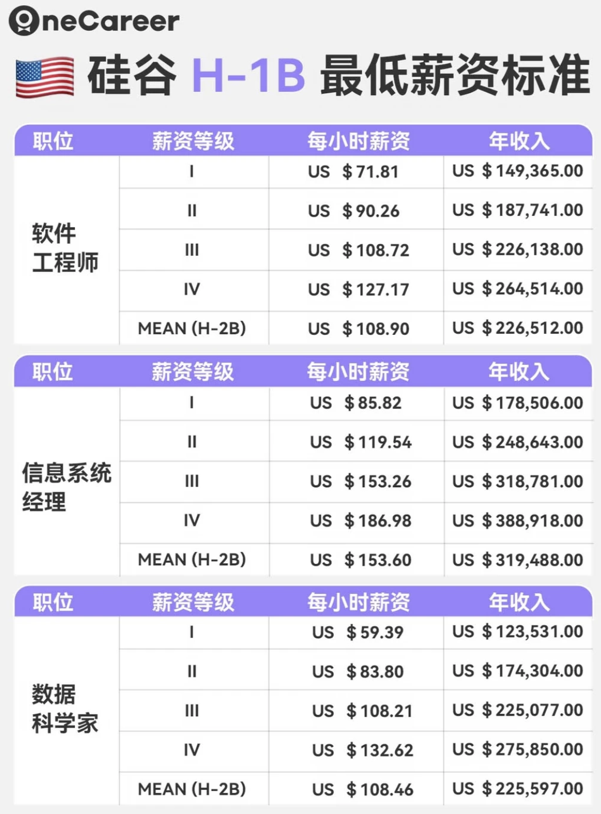
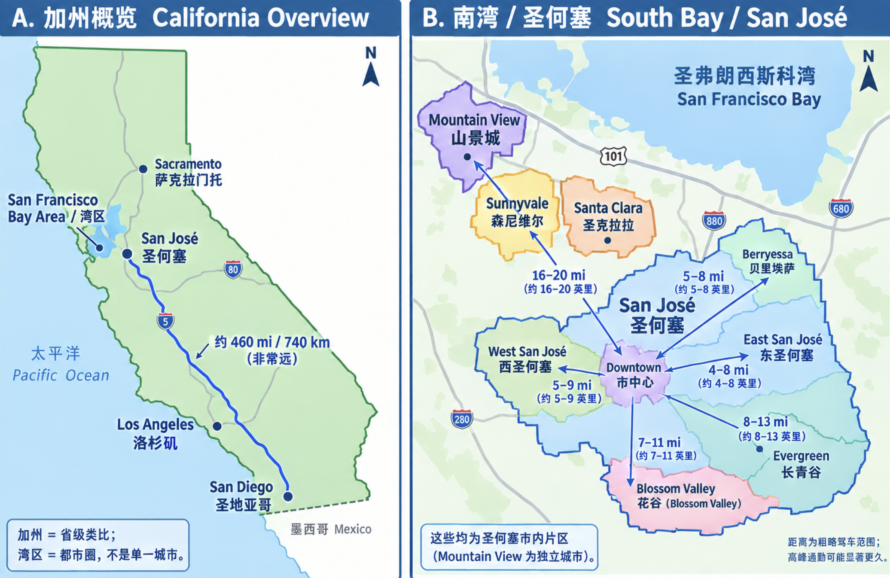

## 时机

##### 路线 B：**宝宝 1.5 - 2 岁时申请**

##### （平衡折中路线 ★★★★★ 推荐）

- **适用心态：** 既不想拖太久（担心公司 H1B/Transfer 政策变动），又想避开最难带的婴儿期。

- **孩子融入：** 完美。

- 双职工带娃情况：

  - 孩子满 2.5 - 3 岁后，在美国可以上 Preschool（Preschool 阶段名额比 Infant 多很多，更好申请）。
  - 孩子有了基础的自理能力（通常要求会自己上厕所 Potty Trained），身体免疫力也大幅提升，生病频率明显下降。
  - 费用比 Infant 阶段有所下降，全天托班的时间（早8晚6）可以完美覆盖双职工的工作时间。

- 时间表

  1. 未来 1 年（宝宝 0 - 1 岁）：国内蓄力

  - **不用急着现在申请**。在这个阶段，把精力放在国内休产假/育儿上，同时在工作中保持高绩效（High Performance），积累业务不可替代性，升职或锁定经理/核心技术岗位（为未来办 L1A 或 L1B 铺路）。
  - 顺便让国内的老人帮衬度过最难带的婴儿期，或者在国内请月嫂/育儿嫂（成本远低于美国）。

  2. 宝宝 1.5 - 2 岁时：正式启动申请

  - 向公司表达 Transfer 意向，寻找美国对口团队的 Headcount。
  - 因为审批和办签证需要 1 年左右，这样等所有手续办好、你们打包搬家到美国时，**宝宝刚好 2.5 - 3 岁左右**。

  3. 落地美国时（宝宝 2.5 - 3 岁）：

  - 此时直接送当地的 Preschool（全天托班），双职工接送无缝衔接。
  - 如果刚去手忙脚乱，可以办 B1/B2 签证让国内父母过来短期帮忙 3-6 个月过渡。

## 身份政策

个人：L-1B

配偶：L-2

老人：B1/B2 探亲签

目标：争取“初始 3 年 + 后续身份预案”

在拿 offer 或和 HR/global mobility 沟通时，争取至少确认下面 6 件事：

1. **初始派驻期限**：2 年、3 年还是更长？能否延期？
2. **到期安排**：回中国岗位是否有保证？还是转美国本地雇佣？
3. **绿卡政策**：美国入职满多久可以启动 PERM/I-140？入职多久可以开始 Sponsor（赞助）绿卡
4. **H-1B 预案**：公司是否每年会为符合条件的 L-1B 员工注册 H-1B？
5. **L-1A 发展路径**：美国岗位是否真有带团队、管预算、管人员的晋升机会？
6. **家庭支持**：搬家费、临时住房、医疗保险何时生效、daycare 补贴或 backup care、配偶求职支持有没有？

| 情况                                          | 最常见路径                                                   |
| --------------------------------------------- | ------------------------------------------------------------ |
| 在中国外企工作、被美国关联公司调动            | **L-1A / L-1B**                                              |
| 美国大学毕业、直接找美国工作                  | **OPT → H-1B**                                               |
| 美国毕业后 H-1B 多年未中                      | OPT/STEM OPT 内继续抽；免抽签雇主；回境外工作后走 L-1；符合条件则 O-1；或离境/继续真实学业 |
| 作为 L-1 主申请人的孩子在美国长大、以后读大学 | 如果孩子本身是美国公民，则不需要 H-1B/L-1；如果只是 L-2 身份，则大学毕业后的工作身份逻辑仍会接近 F-1 → OPT → H-1B |

英语、项目影响力和内部关系准备好，等待更成熟的窗口。

## 签证路径顺序

→L-1B 赴美

→1/3年内抽取H1B工签(竞争激烈，但2026年解决了印度人挂靠公司一人多抽的condition后有所好转)

> 从2026年开始，H1B抽签将与薪资挂钩，实行 加权抽签 。美国劳工部（DOL）将每个地区的每个职位都划分为四个薪资等级，你的Offer薪资决定了你属于哪个等级，从而获得相应的抽签次数：
>
> \- Level 1 (入门级): 1次抽签机会
>
> \- Level 2 (合格级): 2次抽签机会
>
> \- Level 3 (有经验级): 3次抽签机会
>
> \- Level 4 (资深级): 4次抽签机会
>
> 
>
> 所以base最好能达到23w美元，能够走level III。

→PERM+I-140

- 审理4-6个月，等待排期3-5年
- 截止至2026年8月，针对中国大陆出生的候选人：
  - EB-1排期为2023/7/1=3年1月；（L-1A走这个）
  - EB-2排期为2021/9/1=4年11月；（L-1B走这个）
  - EB-3排期为2022/1/1=4年7月；
  - EB-3 Other Workers排期为2019/5/1=约7年3个月

→I-485(约6个月)

→绿卡

https://www.zhihu.com/question/1978860591989954103/answer/2070459663552980841?share_code=1lh5DPadEuuyr&utm_psn=2090556064118857768

## 小孩教育

还是回国读中国的义务教育比较好。

> 根据美国宪法第十四修正案（出生地原则），只要在美国出生就是美国公民。美国公民在海外读书、生活多久，都不会失去美国国籍（美国公民身份没有像绿卡那样的“居住时间要求”）。

可以在美国再生一个小孩，小孩满21岁后可以担保家人绿卡（父母无排期，兄弟姐妹需要排十多年）。同样是回国读中国的义务教育更好：

- **情况 A（父母双方无外国绿卡/永居，持签证在美生子）**：孩子在中国法律眼里**具有中国国籍**（属于事实上的“国籍冲突”）。孩子回国办的是《中国旅行证》，回国后**可以正常落户、上公立学校/私立学校/国际学校**，与普通中国籍孩子待遇一样。

  > **“18岁必须选国籍”是一个广泛流传的误区（谣言）**。 只是：
  >
  > - 美国：18岁成年后拥有完全民事行为能力，可以**自主决定是否退出国籍；**
  >
  > - 中国：
  >
  >   - 《国籍法》第九条规定：*定居外国的中国公民，自愿加入或取得外国国籍的，即自动丧失中国国籍*。
  >
  >   - 美宝出生拿到美国国籍是基于美国宪法的**“出生地原则自动赋予”**，既**不是自愿申请加入**的，父母当时也**没有定居外国（无绿卡）**，因此**不适用第九条**，不会自动丧失中国籍。
  >
  >   - 《国籍法》第三条规定“不承认中国公民具有双重国籍”。
  >
  >     它的实际含义是：**“中国政府只承认你的中国公民身份，视你为纯粹的中国公民；你在外国拿的那本护照，在中国法律眼里是不被承认的无效证件”**。
  >
  >     也就是说，中国政府不会逼你退掉外国籍，而是直接**“无视”**你的外国国籍。
  >
  > 
  >
  > 在现实的法律操作中，**孩子既不需要、通常也无法在此时去“二选一”放弃其中一个国籍**。这种情况在国际法和中国官方的处理中被称为**“国籍冲突”**（Nationality Conflict），并非普通意义上的自愿持有双重国籍。

  | 场景           | 中国政府的视角                             | 美国政府的视角                           |
  | :------------- | :----------------------------------------- | :--------------------------------------- |
  | **法律认定**   | 孩子是**中国公民**（因为父母无外国永居）   | 孩子是**美国公民**（因为出生在美国领土） |
  | **对方护照**   | 不承认其美国护照，视为无效                 | 承认/默许孩子同时拥有其他国籍            |
  | **进出境证件** | 必须使用**《中国旅行证》**进出中国         | 必须使用**《美国护照》**进出美国         |
  | **国内待遇**   | 可正常上户口、办身份证、享受公立教育及医保 | 享有美国公民所有权利，无需维护居住时间   |

- **情况 B（父母出生时已持有美国绿卡/永居）**：孩子不具有中国国籍。孩子需要办《中国签证》入境，在国内通常只能就读纯外籍人员子女学校或部分接收外籍学生的私立/公立国际部，且需要定期办理在华居留许可。

- 想以“国际生”免试考国内大学的限制

  很多家长误以为美宝 18 岁就能直接按“留学生/国际生”申请清北等名校。根据中国教育部现行规定，父母双方或一方为中国公民的，美宝必须持有**有效外国护照满4年**，且近4年内有在**国外实际居住2年以上**的记录，才能按国际学生标准报考。如果一直都在中国国内读书，是不能直接按国际生资格申请的。

国内的K12教育比较扎实，国内的本科教育比较划算，只是最好能去top2。然后去美国读博是可以的，通常有奖学金。

有绿卡+州内实际居住&缴税满一年以上，**本州学生（In-State）**读州内的公立大学是有很大折扣的。 这种建议也至少在国内读完初中再来美高，学习上秒杀美国学生。（我认为美宝可以作为国际生申请清北和美国名校、绿卡宝可以读美国的公立大学，或参加华侨生联考，卷度比高考低。但个人认为美国大学更值得读）

## 地理环境

| 美国行政概念          | 地名示例                                | 中国行政区划类比                     | 说明                                  |
| :-------------------- | :-------------------------------------- | :----------------------------------- | :------------------------------------ |
| **州 (State)**        | **加利福尼亚州 (CA)**                   | **广东省**                           | 面积大、经济最发达的省份。            |
| **大区 / 都市圈**     | **北加州 / 旧金山湾区 (Bay Area)**      | **珠三角 / 广佛莞都市圈**            | 高科技企业扎堆的区域。                |
| **远方另一大城市**    | **圣地亚哥 (San Diego)**                | **湛江市 或 汕头市**                 | 位于“省内最南端”，离核心区非常远。    |
| **地级市 (City)**     | **圣何塞 (San Jose)**                   | **深圳市**                           | 湾区核心特大城市、硅谷中心。          |
| **邻近地级市/区**     | **山景城 (Mountain View)**              | **东莞市 / 紧挨深圳的独立行政区**    | Google 总部所在地，与圣何塞紧密接壤。 |
| **市辖区 / 街道板块** | **Downtown、西/东圣何塞、Berryessa 等** | **福田区、南山区、龙岗区、特定街道** | 圣何塞市内部的不同片区/社区。         |

## 创业方式

双引擎：美国给方向，中国给速度。

对做AI+软件/App/Agent来说，这种组合天然适配。

软件是没有国界的。

你可以在美国拿到最新的技术、最明确的需求、最愿意付费的用户，这儿的“前台资源”全球最强；

但你在国内能以最快速度把产品做出来、测试、上线，这里的“后台效率”全球第一。

> 节奏：
>
> 在美国：拿方向、聊客户、找合作、看趋势
>
> 在中国：带团队、冲版本、做工程、搞交付
>
> 再飞美国：demo、谈用户、跑场景
>
> 回中国：继续迭代

这不是两头累，而是两头加速。你会突然拥有别人没有的优势。美国创业，中国生活，是顶配也是自由。

## 初步计划

• D去，Y不去，D工作两三年体验。if Y 稳定：D通过人脉transfer回agent相关的部门 else：D transfer回wh。

• D、Y都去，宝1岁半～2岁再去。宝5岁回，准备国内入学。D、Y在宝5～8岁之间回。

## 培养能力

软实力、企业政治：

https://www.youtube.com/watch?v=KhjhRRz3VJw

> 一些观点：
>
> 1. 增加曝光度，the world favors extroverts（近百年来，世界偏爱外向的人）
>
> 2. 优秀的管理者或工程师都是a little thorny（多刺的）。因为他们不被公正对待时会push back。不是轻易拿捏的。学会争取，学会拒绝，和学会谈判。
>
>    一个团队应当有一些有野心和pushy的人，才能做出影响力。人类所有进步都是一些不讲道理的人完成的。但全是这样的人也不好，会互相吞噬，引起混乱。
>
> 3. 如果想晋升到譬如manager，去更有机会的地方。去一个正在发展、有增长的地方。另外管理者不是读心术士，你要保证他们知道你想要这个角色。第二点是，你可以问他们，“尽管困难重重，满足什么条件，你会将我作为下一个[某个角色]的首选”。“我需要做到哪些，你会有信心在评审会提议我的晋升”。
>
>    学会救火，给管理者留下印象：什么事情让你夜不能寐，什么你最需要，我会着手处理这些事。  问到最棘手的问题，并在危机关头做奉献。 —— 达成一项双赢的交易，我帮助他们，他们也想帮助我。
>
>    不过这些做法要一步一步来，和任何人际关系一样，就像和女生约会一样，要慢慢升温，温水煮青蛙，这样不会让人感到诡异。这就像慢慢建立一种work marriage。
>
>    Ethan提供一个小窍门，用AI来分析人的性格，截取他们的一些通信记录，把所有数据交给AI，然后说：分析此人的沟通方式，我的目标是...[想申请升职]，我该怎么做，接近这个人。     我并不是说要操纵（manipulation），而是说利用AI来学习如何与你性格不同的人沟通。但一个充满操纵的时代即将到来。
>
>    Ethan推荐一本书《Never Split the Difference》关于谈判的。
>
> 4. 有一种情形值得分析，就是自己的manager是否会进一步晋升，从而带动整个团队有更多晋升空间。
>
>    1. 情形1：+1也想晋升。
>
>       “我已经分享了我的职业目标，我一直在想这个问题。看起来好像...你正在寻找更好的机会，你也渴望晋升。是真的吗？有什么办法我可以帮你吗？”
>
>       如果有的manager不愿意这么直白，可以委婉的说：“公司的奖励机制是怎样，我能否帮助我们小组获得更多奖励？”
>
>    2. 情形2：+1不愿意或不想争取晋升，或认为这不可能发生。
>
>       如果你没有耐心了，你可以考虑从下面脱身。“嘿，我想...向上移动，如果我们团队无法创造这样的机会，你能帮我找到另一个组织吗？我可能成为一名您和我们领导层的不错的形象大使，在其他地方。你愿意帮忙吗？我晋升或者找个地方落脚？”
>
>       有的+1不愿意你走，可以说“我的事业对我非常重要，所以我打算晋升，我很想在这里和你一起做这件事，但是我必须这么做”。   可以提一些家庭因素，打感情牌，表示为什么你想抓住的晋升窗口期这么紧迫。
>
>       找到那些雄心勃勃的人。现在，这些人中有些会想方设法让你累死，那是另一套护栏（guard rails）。但去找一个和你志同道合的人吧，互相成就。
>
>    3. Ethan作为一个资深的高管，他不喜欢那些像睡着的人。他们不想那么努力工作，或者他们似乎对某些问题感到愤怒，但他们是被动攻击型（passive aggressive），不会公开这些问题，以至于Ethan也没法解决这些问题。
>
> 5. 一个即受人喜欢 又 表现出色的人，会很稳固的掌握权力。be thorny and be likable. you can do both. 意味着你是友善的、外向的、愉悦的、健谈的，除非有人做你不喜欢的事情。这时你有a little push back，just that little face。有时你可以幽默一点，比如用有趣的比喻设定一些你的框架。 让你讨人喜欢又风趣幽默，但同时会画线。
>
>    你不用像一个super lovable teddy bear，just be a decent person.
>
> 6. 更高阶的，如果有人明显使坏。要知道speed matters，比如有人背后咬你一口，或者你看到有人咬人，你可以预期他也会对你这么做。抢在第一时间和管理层说 “嘿，我不知道你知道吗，但这其中存在一些破坏性因素（undermine），我们有一个很有竞争力的团队，有些人会攻击每个人，我永远不会那样做，但是这意味着我指望你认出它，因为我不会玩那种游戏，但我指望你能看到，请以我的实际所做的事情来衡量我的表现，而不是听别人怎么说”。
>
>    你已在他们心中种下了种子，而不指责任何人。
>
> 7. 很多黑暗面的企业政治，可能使得事情不是最优解。最优解肯定是管理层好，员工都很正直，整个公司欣欣向荣带来更多机会。因为并不非得是零和博弈或者囚徒困境。
>
>    但是这种情况有时确实会发生，所以要有一些智慧应对。
>
>    另外你可以选择跳出这个处境。
>
> 8. 找到自己竞争力最容易施展的地方。找到适合你的地方。
>
>    Ethan有三个天赋，第一他擅长公共演说，第二他很了解职业发展，第三他很熟悉社交媒体。  虽然他不是最厉害的演说家，也不是最了解的职业的人，也不是最受欢迎的自媒体。但当这三个领域交叉时，Ethan就非常接近那个最佳的人选，不会受到他人竞争。
>
>    这就是Ethan开始从事定制化职业咨询和一对一高管教练的原因。 
>
> 9. empire building把hc用完，人会自我rationalize，我招这些人是为了做出更大的成果。
>
> 10. 在项目里保持领先，别陷进去。展现进展，然后迭代。而不是陷入技术细节。 因为if I can't see it, it's not real.
>
> 11. Ethan认为AI时代，学习的广度 比 深度更重要。更重要的是关注价值走向：人们重视什么？
>
>     更多人可以写更多代码，但更重要的是，谁来做决定？谁来解释这些？谁是决定需要什么？由谁来决定发布优先级是什么？谁来负责？谁决定该如何向客户传达信息？
>
>     假设Gmail的工程师现在可以编写十倍于现有功能。但我们不需要十倍的功能，相反，我们或许需要更少、更好、或更不同的功能。谁来做决定？整体品味或判断力 将会非常珍贵。
>
>     我宁愿坐在审判席上，而不是在工具操作台上。
>
> 12. 现在大厂很多裁员。一方面，如果是整个组织被裁，或大规模裁员，不再像以前那样有污渍了。剩下就是如何防止这种情况玷污你的名声，你可以把过去的真相快速带过，事实就是如此，你转身了。
>
>     “是的，很不幸，我的组织被淘汰了。但好消息是，___________（请补充你的故事，向其他公司兜售） 这让我有机会尝试一些新事物。那实际上给了我一个机会来带来元哲学或元洞见，给我一个机会让我能分享亚马逊的经验以规模化的方式呈现给你” ，快速转移话题，来探讨未来。  
>
> 13. executive presence（领导者风范）。
>
>     > executive presence是一个人让别人觉得"这个人有领导力、值得信任、能担大事"的整体气质。
>
> 14. 建立人脉关系。有一个诀窍就是：弄清楚你的爱好，你热情的事物，你愿意分享的事物，你自豪的事物，你感兴趣的事物。 然后致力于这些事情，并且稍微想一想怎么将它“给予”他人一些价值。
>
>     take what you like doing and give it away. 
>
>     怎么让它可获取，怎么打包成一个工具，怎么提供建议，怎么教授他人，怎么给个讲座。关键在于“给予（give）”。
>
>     这样既简单又有趣。
>
> 15. 《Leadership and Self-Deception》：有时候我们把人物化，对待人仿佛他们是API，按下正确的按钮就能得到想要的响应。这样通常得不到好的反应。因为人们会觉得自己被操纵。但如果你对待人带着温度，他们更愿意帮忙解决问题。
>
>     从贝佐斯身上学到的[例子](https://www.linkedin.com/feed/update/urn:li:activity:7183820084774084610)：当一个员工有困难或者犯了大错，他们不需要训斥，他们自己内心已经很煎熬了，他们需要的是支持。这让他能待在这儿致力于解决问题，而不是致力于找一个新工作。
>
> 16. 如果想要速通成为VP（副总裁），
>
>     第一点，选择高增长的地方。Ethan不会选择留在亚马逊。因为今日的亚麻不同往日，不再有高增长，（亚马逊现在有5万个L5级别的员工），意味着不再有无尽的机遇。如果想要速通，Ethan会选择：先在亚马逊工作18～24个月，尽可能吸收信息和技术，提升技能。成为某项技能的专家，这项技能被业界买账，比如AWS，我会努力成为足够精通AWS的专家。这样需要AWS知识的人，会以优厚的待遇聘用我。在高增长的地方担任更高职位。
>
>     找一个需要云计算的高增长的公司，然后向他们推销，把我带进去，我将会是你适应的解决方案。实现你的承诺后，跟他们谈谈，我该如何晋升，我想以这种方式成长，我想领导。
>
>     第二点，需要一些管理技能。你必须胜任这份工作，你要学习心理学、组织、风险采取、决策。
>
>     第三点，喜欢冒险。去取得重大胜利，可以因为某些原因错失一些胜利。你总可以在一家公司遭遇灾难，然后尝试在其他地方再试一次。最终，如果你进行足够多的大挥杆，你会打中一个。 也就是如果成功了就向上晋升，如果不成功，就再跳槽一次。最终速通VP，但这可能是第三或第四家公司。
>
>     在游戏里，速通的反义词就是完成所有内容的完整游戏流程，那样速度很慢，糟透了。
